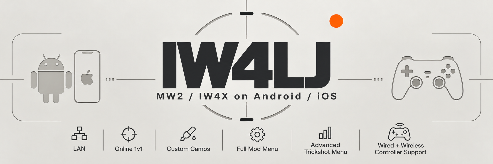
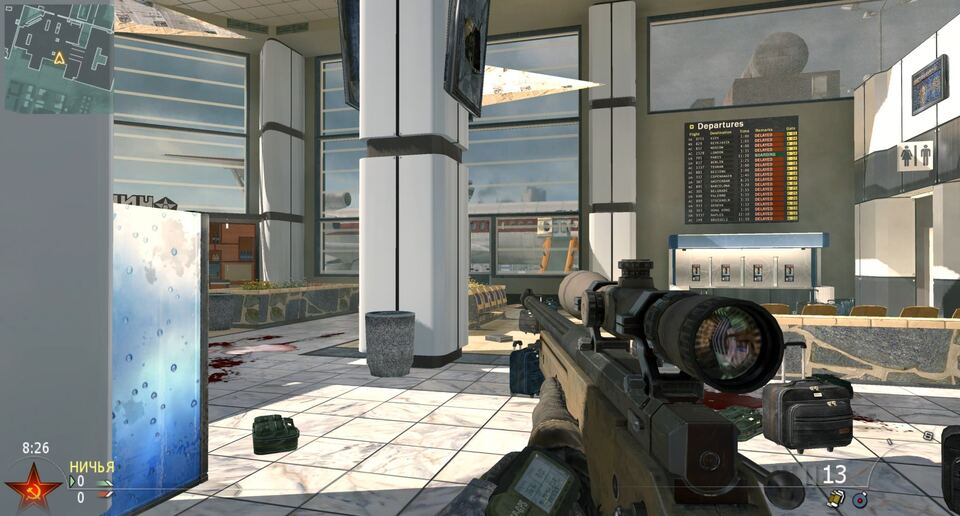
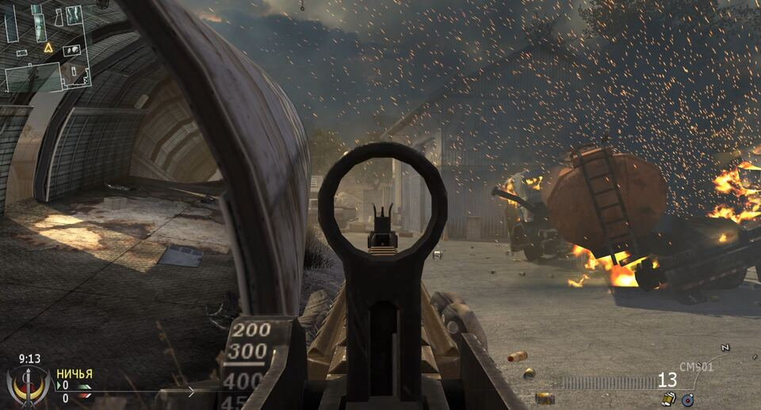
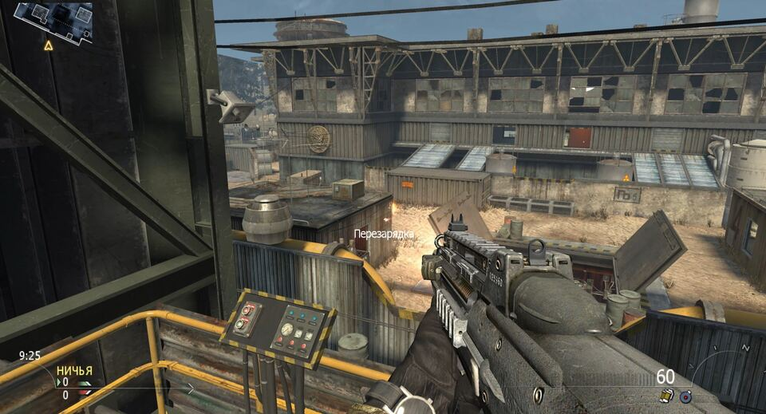
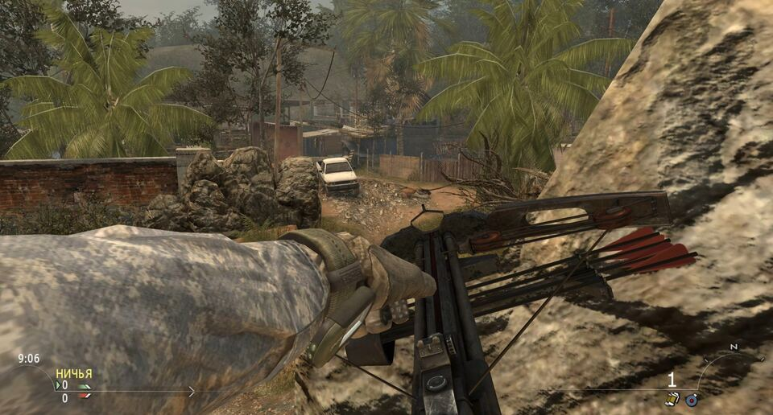

# IW4LJ

**Call of Duty: Modern Warfare 2 (2009) multiplayer on your phone** — Android and iPhone.

IW4LJ is a phone port of **IW4L** (by vladtrc), an open-source runtime for MW2 written in
Rust with the [Bevy](https://bevy.org/) engine. It is not a wrapper or an emulator: it
reads the game data from a copy of MW2 you own and runs it in its own engine, with touch
controls, controller support and a mod menu built for a phone. Android and iPhone players
can play together over LAN and online.

> **You need your own copy of MW2 multiplayer.** This repository contains source code only,
> no Activision game data. See [No game files here](#no-game-files-here).

  
  
  
  

## Download

| Platform | Download | Install guide | Status |
|---|---|---|---|
| **Android** 12+ (arm64) | [**IW4LJ.apk**](https://github.com/jesaias1/IW4LJ/releases/latest) | [INSTALL-ANDROID.md](INSTALL-ANDROID.md) | Playable. Tested on a Galaxy S23. |
| **iPhone / iPad** (iOS 16+) | [**IW4LJ.ipa**](https://github.com/jesaias1/IW4LJ/releases/tag/ios-v0.2.0) (unsigned) | [INSTALL-IOS.md](INSTALL-IOS.md) | **Not yet tested on a device.** Expect rough edges. |

The iPhone build is unsigned: you sign and install it with Sideloadly or AltStore using a
free Apple ID (it must be re-signed every 7 days). Sign-in sometimes fails with an Apple
server error; the install guide has a fix list.

## Features

| | |
|---|---|
| **Real MW2 multiplayer** | 16 maps (Afghan, Derail, Estate, Favela, Highrise, Invasion, Karachi, Quarry, Rundown, Rust, Scrapyard, Skidrow, Sub Base, Terminal, Underpass, Wasteland), the original weapons, perks, killstreaks, HUD, scorebars and final killcam. |
| **Built for phones** | Touch controls with an on-screen pad, plus full **Bluetooth / USB controller** support with rumble. Draws under the camera cutout and respects the safe area. |
| **Play with friends** | **LAN and online**: one phone hosts, the others join from the LAN tab or by IP. **Android and iPhone can play in the same match.** |
| **Bots** | Add 1 or 5 bots, still bots, freeze them, make them fire. Good for practice and 1v1 setups. |
| **Mod menu on the phone** | Tap **MENU** (or three-finger tap, or the controller's home button) for tabs: **LAN, TRICKSHOT, SKINS, MATCH, BOTS, MAPS, ACCOUNT, GRAPHICS**. |
| **Progression** | Unlock everything in one tap, set prestige 0-10, or reset. Your profile and settings are saved between launches. |
| **Weapon skins** | Paint your gun from the SKINS tab. |
| **Trickshot toolkit** | Noclip, god mode, **explosive bullets** (every shot also bursts where it lands, so you don't need a perfect hit), save / load a position, spawn at the saved spot, still bot, "next kill wins" final killcam, trickshot search and destroy, 1 HP, ammo refill. Controller shortcut: **hold Select, D-pad left saves, D-pad right loads**. |
| **Performance controls** | Held to **60 fps** by default to stay cool in long sessions; **FPS 90 / FPS 120** buttons for strong phones. Render resolution and texture quality settings for weaker ones. |
| **Helpful errors** | If the Android app cannot start it shows what went wrong (game files found?, saved error, device) with Copy / Share buttons, instead of a black screen. |
| **Open source** | Rust and Bevy, Apache 2.0, source for both ports in this repo. |

Gameplay is still incomplete: expect missing behaviour, bugs and the occasional desync.

### Trickshot tools

The mod menu's **TRICKSHOT** tab gives you noclip, god mode, **explosive bullets** (a toggle; it is a cheat, so it only works in your own hosted match), saving and loading a position,
respawning at the saved spot, a still bot to shoot, "next kill wins" for a final killcam,
a trickshot search and destroy setup, 1 HP and ammo refill.

With a controller, turn on **PAD SAVE/LOAD**: hold **Select** and press **D-pad left** to
**save** your position, **D-pad right** to **load** it. The sticks and every other button
stay as normal (sprint is still the stick click). While it is on, Select is used only for
this.

### Controls

| Action | Touch | Controller |
|---|---|---|
| Move | left thumb | left stick |
| Look | right side | right stick |
| Fire / aim / jump / crouch / reload | on-screen buttons | triggers and face buttons |
| Mod menu | **MENU** button (top right) or three-finger tap | controller's Xbox/PlayStation button |
| Save / load position (trickshot) | menu buttons | Select + D-pad left / right (when enabled) |

### Performance

- The game is held to **60 fps** by default to keep the phone cool over long sessions.
  Strong phones can pick **FPS 90** or **FPS 120** in the mod menu's **GRAPHICS** tab.
- **Render resolution** and **texture quality** are also in **GRAPHICS** and apply at the
  next launch. Lower them on phones that struggle.
- 6 GB of RAM or more is recommended. Long sessions on some phones dip below 60 fps.

## Quick start

1. Install the app (see the table above).
2. Open it once so it creates its folder.
3. Copy the `zone` and `main` folders from your MW2 multiplayer install into the app's
   `mw2` folder on the phone (about 12 GB). The exact path is in each install guide.
4. Open the app, tap **MENU**, and start a match: pick a map, add bots, play.

If the Android app fails to start, it shows a report instead of a black screen: whether
the game files were found, the saved error and your device. Use **Copy** or **Share** and
send it with your bug report.

## Frequently asked questions

**Is this a copy of the game?** No. It is an engine; the maps, models, sounds and
textures come from your own MW2 files. Without them it will not run.

**Which files do I need?** The `zone` and `main` folders of Modern Warfare 2 *multiplayer*.
`zone/english/common_mp.ff` must be present.

**Can I play with friends?** Yes, on the same Wi-Fi (LAN tab: host or join) or through a
community server file. Both phones must run builds from the same revision, which is also
what lets Android and iPhone play together.

**Will it run on my phone?** Android 12 or newer, arm64, ideally 6 GB RAM or more. A recent
Snapdragon phone does best. If it does not start, the error screen tells you why.

**Is it on the Play Store / App Store?** No. Android uses a downloadable APK. iPhone needs
sideloading; a paid Apple Developer account would allow TestFlight later.

**Why is the iOS version "untested"?** It builds and type-checks, but nobody has run it on a
real iPhone yet. Reports are very welcome.

**Is this legal?** It does not modify or redistribute the game's files and uses none of
Activision's servers. It is an unofficial project; use it with your own copy and at your
own risk.

## Reporting a bug

Open an [issue](https://github.com/jesaias1/IW4LJ/issues) with: phone model and OS version,
which port and release you used, what you did, and what happened. If the app showed an
error report, paste it. Screenshots and short videos help (for example for model,
animation or killcam glitches).

## How the repository is laid out

| Folder | What it is |
|---|---|
| [`IW4LJ-Android`](IW4LJ-Android) | Android port (the full engine and the Android app). Docs in [`docs/`](IW4LJ-Android/docs): [`ANDROID.md`](IW4LJ-Android/docs/ANDROID.md), [`ANDROID-DEVICE.md`](IW4LJ-Android/docs/ANDROID-DEVICE.md), [`ANDROID-HANDOFF.md`](IW4LJ-Android/docs/ANDROID-HANDOFF.md) |
| [`IW4LJ-iOS`](IW4LJ-iOS) | iPhone / iPad port. Docs: [`ios/README.md`](IW4LJ-iOS/ios/README.md), [`ios/docs/IOS-DEVICE.md`](IW4LJ-iOS/ios/docs/IOS-DEVICE.md) |

The two folders are separate, complete copies of the engine so each build stands on its own.
A change to the game, the netcode or the menus has to be made in both, or the two ports
stop being able to play together; see
[`IW4LJ-iOS/ios/docs/PORTS.md`](IW4LJ-iOS/ios/docs/PORTS.md).

Under the hood (details in the engine docs): native readers for the game's FastFile data,
retail Direct3D 9 shader bytecode translated to WGSL, one shared simulation step for the
server, client prediction and replays, and custom UDP networking where the host simulates
the match.

## No game files here

This repository contains source code only. It contains **no** Activision game data: no zone
files, IWDs, textures, sounds or maps. Call of Duty and Modern Warfare are trademarks of
Activision; this project is unaffiliated with them.

## Credits

- **IW4L** by vladtrc, the engine this is built on, and its contributors and testers
  (notably ju1cedr1nker and silvernote03).
- Phone ports, touch interface, mod menu and Android/iOS work: **jesaias1**.
- Asset and protocol research thanks to
  [OpenAssetTools](https://github.com/Laupetin/OpenAssetTools),
  [IW4x](https://github.com/iw4x/iw4x-client) and
  [KisakCOD](https://github.com/SwagSoftware/KisakCOD).

Much of this code is written with the help of an LLM; treat it as work in progress.

## License

Source licence: Apache 2.0 (see each folder's `LICENSE` and `NOTICE`).
